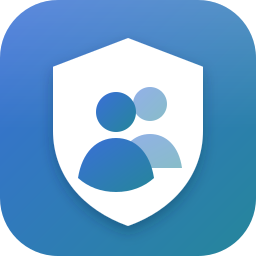

<p align="center">
  
</p>

<h1 align="center">Steam Account Helper</h1>

<p align="center">
  Keep all your Steam accounts in one place and sign in to any of them with a single click, Steam Guard code included.
</p>

<p align="center">
  <a href="https://github.com/Jusmejtr/SAH/releases/latest"></a>
  <a href="https://github.com/Jusmejtr/SAH/actions/workflows/ci.yml"></a>
  
</p>

---

## Features

- **One-click login.** Click an account and the app restarts Steam, signs in and enters the Steam Guard code for you.
- **Steam Guard codes.** See the current code with a countdown and copy it with one click, the same as the Steam mobile app.
- **Steam Guard setup.** Add a Steam Guard Mobile Authenticator to an account straight from the app. The app shows the revocation code and lets you save a `.maFile` backup.
- **Import and export:**
  - text lists with your choice of delimiter and column order
  - `.maFile` files from Steam Desktop Authenticator
- **Account management.** Search, edit, delete one account or several at once, and set a display name for each account.
- **Secure storage.** Passwords and secrets are encrypted with the operating system's credential storage and stay on your computer.
- **10 languages:** English, Español, Deutsch, Français, Português (Brasil), Polski, Magyar, Русский, 日本語, 简体中文
- **Light and dark mode.**
- **Automatic updates.** The app tells you when a new version is out.

## Download

Get the latest version from the [**Releases**](https://github.com/Jusmejtr/SAH/releases/latest) page:

| File | Use it if… |
| --- | --- |
| `Steam-Account-Helper-Setup-vX.Y.Z.exe` | you want a normal installation with Start menu and desktop shortcuts |
| `Steam-Account-Helper-Portable-vX.Y.Z.exe` | you want a single file to run without installing |
| `Steam-Account-Helper.AppImage` | you are on **Linux** (updates itself in place) |

> [!NOTE]
> Automatic login works on **Windows** and **Linux**, and Steam has to be installed.

### Linux

1. Make the AppImage executable: `chmod +x Steam-Account-Helper.AppImage` (or tick *Allow executing as program* in the file's properties), then run it. Keep it in a folder you can write to (for example `~/Applications`) so it can update itself.
2. If it doesn't start, install FUSE 2: `sudo apt install libfuse2` (on Ubuntu 24.04 and newer: `libfuse2t64`).
3. Passwords are stored in your system keyring, so you need **GNOME Keyring**, **KWallet** or another Secret Service provider (for example KeePassXC). Most desktops have one already.
4. Steam from your distribution, the **Flatpak** (`com.valvesoftware.Steam`) and the **Snap** are all supported. Start Steam once on its own before the first automatic login.

## Getting started

1. Click **Add account** and enter your username and password.
   - If the account already has a mobile authenticator, paste its **shared secret** so the app can generate the codes.
   - If it has none, choose **Set up Steam Guard** and the app adds an authenticator for you.
2. Click the account card to sign in.
3. Right-click a card for more options: Steam Guard code, edit, save `.maFile`, delete.

### Importing a list

Each line holds one account. Pick the delimiter and column order in the import dialog. For example:

```text
username:password:sharedSecret
username:password:sharedSecret:Display name
```

## Feedback

Found a bug or have an idea? [Open an issue](https://github.com/Jusmejtr/SAH/issues/new). If something goes wrong during login, click **Log** in the bottom bar and attach the log to the issue.

## Disclaimer

Steam Account Helper is not affiliated with or endorsed by Valve Corporation. Steam and Steam Guard are trademarks of Valve Corporation. Use at your own risk.
